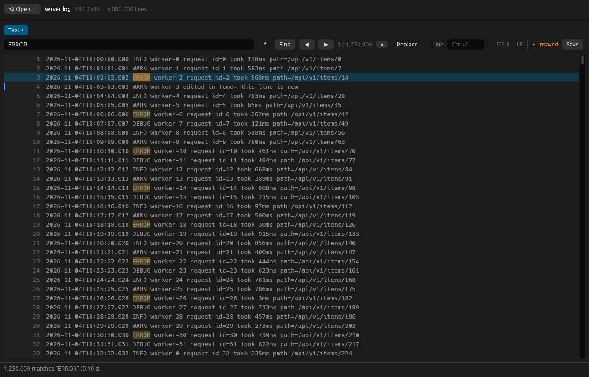
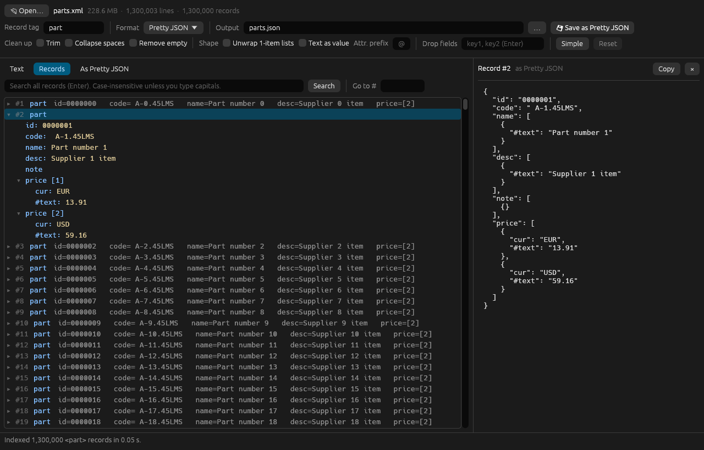
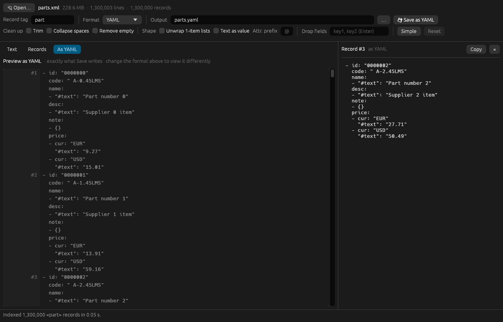
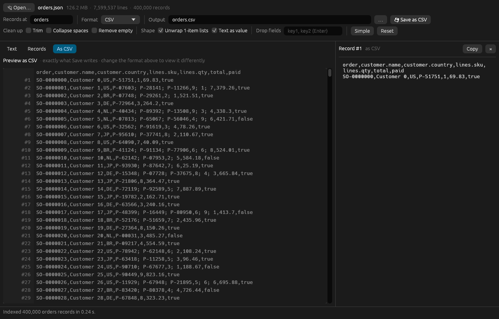

# Tome

[](https://github.com/Peckage/tome/actions/workflows/ci.yml)
[](https://github.com/Peckage/tome/releases)
[](LICENSE)

**A text editor, viewer and converter built for huge files.** Tome opens a 500 MB file in a fraction of a second, scrolls and searches millions of lines without loading them, edits them, and converts XML and JSON to JSON, NDJSON, YAML, XML, CSV or TSV. You can preview the result live before saving.



## Highlights

- **Instant on huge files.** Files are memory-mapped and indexed on all cores. A 448 MB log with 5 million lines opens in 0.04 s and searches in 0.02 s. Only what is on screen is ever decoded.
- **Edit anything, any size.** A piece table over the mapped file makes edits cost microseconds. Undo/redo, find & replace with regex groups, and safe saves (temp file and rename) that keep line endings byte for byte. Save + reopen of 448 MB takes 0.31 s.
- **Records view.** XML and JSON files are split into records: browse 1.3 million records as a tree, and search them in parallel.
- **Live format preview.** Switch between Pretty JSON, NDJSON, YAML, XML, CSV and TSV and see the whole file in that format in under 10 ms, then save exactly that.
- **Clean-up on the way out.** Trim, collapse whitespace, remove empty values, unwrap one-item lists, drop fields, or use xmltodict-style output.
- **Correct.** XML→JSON is byte-identical to a Python reference across 1,000+ generated documents. Every format is checked against a Python model, and the editor is tested against a random model. CI runs on Linux, Windows and macOS.

| Records view | Live preview as YAML | JSON as CSV |
|---|---|---|
|  |  |  |

## Speed

On a 501 MB XML file with 2.6 million records (20-core i7-13650HX, file already in the page cache):

| Step | Time |
|---|---|
| Open, count lines, guess record tag | 0.12 s |
| Index every record (browse/scroll) | 0.12 s |
| Search all records | 0.3 s |
| Convert to compact JSON (483 MB) | 0.48 s |
| Convert to pretty JSON (951 MB) | 0.64 s |
| Previous Python version (compact) | 29.3 s |

Other formats on a 229 MB file with 1.3 million records take 0.25–0.6 s each (CSV is the slowest, because it finds every column first).

## Install

Download the file for your system from the [latest release](https://github.com/Peckage/tome/releases/latest).

### Windows 10 and 11 (x64)

- **Installer:** run `tome-vX.Y.Z-windows-x86_64-setup.exe`. It installs for your user only and needs no administrator rights. You get a Start menu entry, "Open with → Tome" for text, log, CSV, XML, JSON and YAML files (Tome is not made the default app), and optionally `tome-cli` on your PATH. Uninstall it from *Settings → Apps*.
- **Portable:** unzip `tome-vX.Y.Z-windows-x86_64.zip` anywhere and run `tome.exe`.

The downloads are not code-signed yet, so SmartScreen may say "Windows protected your PC": choose **More info → Run anyway**.

`tome.exe` is the app: it opens no console window. In a terminal (cmd, PowerShell, Windows Terminal) use **`tome-cli.exe`**, which is the same program as a console program, so the shell waits for it, shows its output and gets its exit code. For example `tome-cli parts.xml parts.json`.

### Linux (x64)

- **Ubuntu, Debian, Pop!_OS, Mint:** download `tome_X.Y.Z_amd64.deb` and open it, or run `sudo apt install ./tome_X.Y.Z_amd64.deb`.
- **Any other distribution:** unpack the tarball and run the installer. It needs no root and puts `tome` in `~/.local/bin` with an entry in the application menu:

  ```sh
  tar xzf tome-vX.Y.Z-linux-x86_64.tar.gz
  cd tome-vX.Y.Z-linux-x86_64
  ./install.sh              # ./install.sh --remove uninstalls
  ```

Either way Tome appears in the application menu and under "Open with" for text, XML and JSON files (it is not made the default app). It needs glibc 2.35 or newer (Ubuntu 22.04, Debian 12, Fedora 36 and later) and works on Wayland and X11. The open and save dialogs use the desktop portal (`xdg-desktop-portal`), which every common desktop has.

### macOS (Apple silicon)

Unpack `tome-vX.Y.Z-macos-arm64.tar.gz`. The build is not signed: right-click `tome` and choose Open the first time.

### From source

With current stable Rust:

```sh
git clone https://github.com/Peckage/tome && cd tome
cargo build --release              # target/release/tome
./install.sh                       # Linux: builds, then installs like the tarball does
```

`.cargo/config.toml` builds for your own CPU (`target-cpu=native`), which is fastest but may not run on other machines. The release builds use `x86-64-v2` (any x86-64 CPU from about 2009 on). On Windows, `cargo build --release --features console` builds the console version.

### Making a release

Set `version` in `Cargo.toml`, commit, and push a matching tag (`git tag v0.2.0 && git push origin v0.2.0`). The [Release workflow](.github/workflows/release.yml) builds and smoke-tests every download and publishes them with checksums. You can also run that workflow by hand from the Actions tab, which builds the downloads without publishing them.

## Text view

Any file opens in the text view: logs, CSV, minified JSON, source code, anything. The file is memory-mapped and its line starts are found on all cores, so nothing is loaded or rendered up front.

| 448 MB log, 5 million lines | Time |
|---|---|
| Open and index every line | 0.04 s |
| Find a word (all matches) | 0.02 s |
| Find with a regular expression | 0.02 s |

A 132 MB minified JSON file that is a single line scrolls just as smoothly, because only the part of each line that fits on screen is decoded.

- **Scroll** with the wheel (Shift+wheel or ←/→ scrolls sideways), PageUp/PageDown, Home/End or the scrollbar.
- **Select** lines by clicking, Shift+clicking or dragging, or with ↑/↓ (Shift extends). Ctrl+A selects everything.
- **Copy** with Ctrl+C or the right-click menu. Copies are capped at 64 MB.
- **Find** (Ctrl+F) highlights every match. Enter or F3 goes to the next one, Shift+F3 to the previous one. The search ignores case unless you type a capital. Turn on `.*` for regular expressions.
- **Go to line** with Ctrl+G.
- The toolbar shows the encoding guess (UTF-8, UTF-16, 8-bit or binary) and the line endings (LF or CRLF).

### Editing

UTF-8 files are editable at any size. Other encodings and binary files open read-only.

| 448 MB log, 5 million lines | Time |
|---|---|
| Change, delete and insert lines | microseconds |
| Save and reopen | 0.31 s |

- **Edit a line** by double-clicking it, pressing Enter or F2, or just typing on a selected line.
  - Enter splits the line at the cursor. Backspace at the start joins it with the line above, and Delete at the end joins the next line.
  - ↑/↓ move to the neighbouring line, and Esc drops the change to the current line.
- **Lines:** Delete removes the selected lines and Ctrl+X cuts them. Ctrl+V pastes below the selection, Ctrl+D duplicates and Ctrl+Enter inserts an empty line. The right-click menu has the same actions.
- **Undo** with Ctrl+Z, **redo** with Ctrl+Y or Ctrl+Shift+Z. Edited lines are marked in the margin.
- **Find & replace** opens with Ctrl+H. *Replace* changes the current match and *Replace all* every match. With `.*` on, `$1` in the replacement inserts the first group.
- **Save** with Ctrl+S and **Save as** with Ctrl+Shift+S. Opening another file, dropping one on the window, or closing the window with unsaved changes asks first.

How it works: the edits are a piece table over lines of the memory-mapped file. Unchanged lines are never copied, so one edit in a 500 MB file costs three small pieces, and undo snapshots are cheap. Saving streams the pieces to a temporary file next to the original. Unchanged runs are copied byte for byte with their own line endings, new lines get the file's line ending (LF or CRLF), and a missing final newline stays missing. The temporary file is then renamed over the original, which is never written in place. Search keeps working while you edit: the mapped file is still searched on all cores, and the hits move to where their lines are now.

The Records and preview views, and the format exports, read the file on disk. Save your edits first, and the export button stays disabled until you do.

XML files also get the **Records** view below. Switch between the two with the tabs above the list.

## Records view (XML and JSON)

`tome` (or `tome any-file`, or drop a file on the window, or Ctrl+O).

XML and JSON files also get two more views.

- **Records** lists one record per row, with a tree to expand.
- **As <format>** (the live preview) shows the whole file in the format picked in the top bar (Pretty JSON, YAML, XML, CSV and so on) without converting anything. Only what is on screen is rendered, so switching formats on a 229 MB file with 1.3 million records takes under 10 ms. CSV and TSV take about 0.2 s, because the column list needs every record. Scroll with the wheel, the keys or the scrollbar. Click a record to select it, and Ctrl+C copies it in that format.

The panel on the right shows the selected record in the selected format. **💾 Save** writes the whole file exactly as the preview shows it, which a test checks byte for byte for every format.

- **Opening** a file maps it into memory without loading or rendering it.
  - **XML:** the app suggests the record tag (the first repeating element). A tag you typed yourself is kept.
  - **JSON:** *Records at* picks the records automatically: the items of the root array, or of the biggest array under the root object. You can also type a key path such as `data.items`, `$` (the whole file is one record) or `lines` (one value per line).
  - **NDJSON and JSON Lines:** `.ndjson`/`.jsonl` files, and any file with several top-level values, give one record per value.
- **Records** are listed one per row. Click a record to expand it into a tree with one `key: value` per line, and click any branch to fold it. The tree hides the always-a-list wrapper to make it easier to read. The panel on the right shows the record exactly as Save writes it, in the selected format, with a Copy button.
- **Scrolling** works with the wheel, PageUp/PageDown, Home/End or the scrollbar, smoothly across millions of records. Only visible records are parsed.
- **Search** looks through every record's JSON in parallel. It ignores case unless the search text has capitals. **Go to #** jumps to a record number.
- **Save** writes any of the formats below, with progress and Cancel. It asks before replacing a file. If you cancel, hit an error or close the window, the previous output stays untouched.

### Output formats

| Format | What you get |
|---|---|
| Pretty JSON | An indented array, exactly like `json.dumps(records, indent=2)` |
| Compact JSON | An array with one compact record per line |
| NDJSON | One compact record per line, no array |
| YAML | A sequence with one item per record. Strings are always double-quoted, so `"00123"`, `"yes"` and `"null"` stay strings in every YAML reader. Numbers with an exponent are written as `1.0e+5` (the same value), because YAML 1.1 readers would read `1e5` as a string. |
| XML | `<records>` with one element per record. For XML input, strings become attributes and lists become repeated child elements, so XML → XML round-trips. For JSON input, values become child elements. Keys that aren't valid XML names are fixed (`1 bad` → `_1_bad`). Control characters that XML can't hold at all (possible in JSON) become `�`. |
| CSV / TSV | One row per record. Nested keys become dotted columns (`price.cur`). `#text` adds nothing to the column name, so `name: [{"#text": "Bolt"}]` is the column `name`. A column with several values (a list) holds them joined with `; `. The columns are every key seen in any record, in order of first appearance. |

Converting JSON to JSON is also a fast formatter: pretty-print a one-line 100 MB file, or minify an indented one. Numbers keep their exact text, and key order and duplicate keys are preserved.

### Clean-up and shape options

They are all off by default, which gives the plain mapping below. They apply to the converted file, the JSON panel, the tree and search.

- **Trim** removes spaces at the start and end of every value.
- **Collapse spaces** turns every run of spaces, tabs and newlines into one space.
- **Remove empty** drops empty strings, nulls, `{}` and `[]` everywhere, bottom-up. A record that becomes empty stays `{}`, so the record count never changes.
- **Unwrap 1-item lists** turns `[x]` into `x`.
- **Text as value** turns `{"#text": "Bolt"}` into `"Bolt"`.
- **Attr. prefix** (XML) puts a prefix in front of attribute names, for example `@id`.
- **Drop fields** removes keys by name wherever they occur. Use the names as they appear in the output, so `@id` when you use a prefix.
- **Simple** sets the last three the way xmltodict does: `@` attributes, plain text values, no one-item lists.

## Command line

```sh
tome parts.xml parts.json                   # JSON array, one compact record per line
tome parts.xml parts.json --pretty          # indented like json.dumps(..., indent=2)
tome parts.xml parts.ndjson                 # one object per line (format from the extension)
tome parts.xml parts.csv                    # also .tsv .yaml .yml .xml .jsonl
tome parts.xml parts.json --tag item        # another record element (default: part)
tome data.json data.csv --records data.items
tome big.json pretty.json --pretty          # reformat JSON
tome parts.xml clean.json --simple --trim --remove-empty --drop internal_id
tome --help                                 # every option
```

The output format follows the output file's extension. `.json` gives compact JSON unless you pass `--pretty`, and `--format NAME` overrides the extension. The exit code is 0 on success and 1 on an error (the message includes line and column).

## Mapping (XML to JSON)

This is the plain mapping. With every option off, the compact output is byte-for-byte identical to the original Python version.


- Attributes become string keys and are never converted to numbers, so `"00123"` stays `"00123"`.
- Child elements always become arrays, even when there is only one.
- Non-whitespace text before the first child is stored under `"#text"`, trimmed. Text after a child (mixed content) is dropped.
- Namespace prefixes are removed (`p:part` → `part`, `xml:lang` → `lang`), and `xmlns` declarations are dropped.
- An element with an attribute and a child of the same name is an error.
- CDATA counts as text. Comments and processing instructions are skipped. Line endings become `\n`, as in any XML parser.
- Input may be UTF-8 (with or without a BOM), UTF-16, ISO-8859-1 or any other declared encoding. Files that aren't UTF-8 are converted to UTF-8 in memory first.

Malformed XML is rejected the same way Python's expat rejects it: unclosed or mismatched tags, junk after the root element, bad entities or characters, duplicate attributes, and so on. One known difference: an undeclared namespace prefix is accepted.

## How it is fast

1. The file is memory-mapped. UTF-8 and the XML character rules are checked on all cores at once.
2. **Parallel scan.** The file is cut into chunks and every core finds tag boundaries in its own chunk, using SIMD-accelerated `memchr`. Each chunk starts at a guessed `<`. A quick sequential pass then checks the guesses, joins the nesting across chunks and rescans any chunk whose guess fell inside a comment or CDATA.
3. **Parallel conversion.** Records are parsed straight from the mapped bytes, copying strings only when entities have to be expanded. They are encoded to JSON in batches on all cores. A writer thread writes the batches in order to `<output>.tmp`, which is renamed when everything has succeeded.

For pretty output most of the remaining time is writing the roughly 1 GB file.

## Tests

```sh
cargo build --release
python3 tests/compare_with_python.py --random 1000   # Rust vs the Python reference, byte for byte
cargo test --release                                 # editor model, window logic, run headless
TOME_BIG=big.xml cargo test --release -- --ignored --nocapture   # timings on a big file
```

`tests/compare_with_python.py` runs about 50 hand-written edge cases, including malformed files, plus random documents. Each one goes through the Python reference in `python/` and through the Rust binary in all three JSON formats. It also checks that the parallel scanner agrees with the sequential one at chunk sizes down to 1 byte.

For each case that converts, it also checks:

- The generic writers give the same bytes as the fast path.
- Joining the live preview's blocks gives the saved file exactly, in all seven formats.
- Feeding the JSON and NDJSON output back in as input gives exactly the same output again.
- The YAML loads (with PyYAML) as the same records.
- The XML output converts back to the same JSON.
- CSV and TSV match a Python model of the flattening.
- Four combinations of clean-up options match a Python model of them.

`python/` holds the original Python/GTK version. It is kept as the reference implementation for these tests.

## Project layout

| Path | What it does |
|---|---|
| `src/text.rs` | Memory-mapped text, the parallel line index, search |
| `src/edit.rs` | The piece table, saving, edit-aware search |
| `src/xml.rs`, `src/pscan.rs` | XML tokenizer, record parser and parallel scanner |
| `src/jsonin.rs` | JSON reader: locating records, parsing with exact numbers |
| `src/node.rs` | Format-neutral records, clean-up options, YAML/XML/CSV writers |
| `src/json.rs` | The JSON writers that must match Python byte for byte |
| `src/engine.rs` | Opening files, the parallel conversion pipeline, the shared encoder |
| `src/gui.rs`, `src/gui/` | The window: text view, records view, live preview |
| `python/` | The original Python version, kept as the reference for tests |
| `packaging/`, `install.sh` | Windows installer (Inno Setup), Linux `.deb` and menu entry, user install script |

## License

[MIT](LICENSE)
